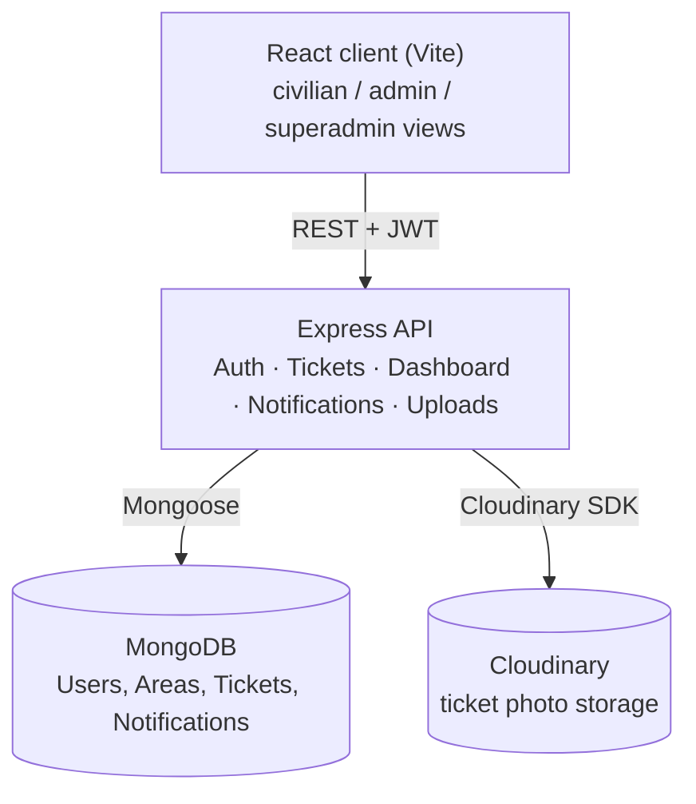
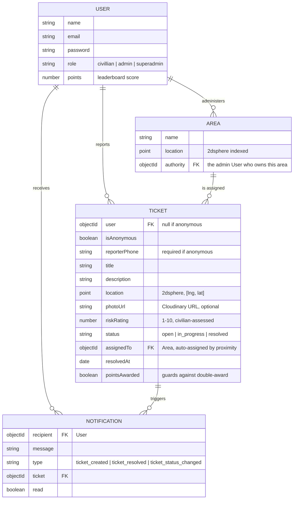
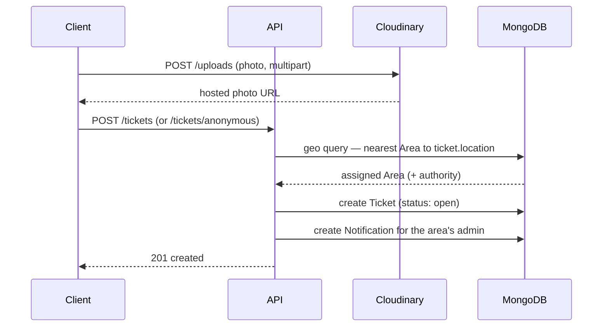
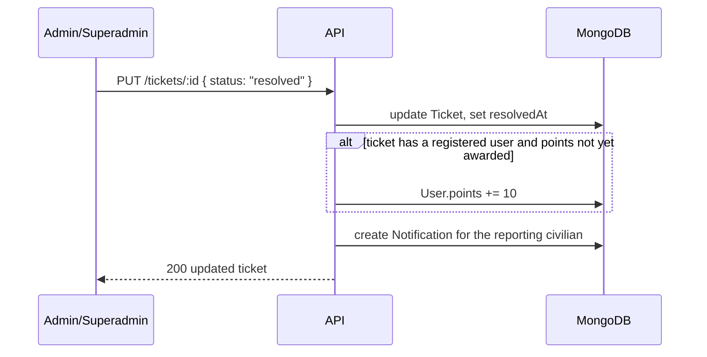

# Road Reporting System

A civic road-damage reporting platform. Civilians report potholes/damaged
roads with a photo, pinned location, and a 1–10 risk rating. Reports become
tickets auto-assigned to the nearest city/district administration, who
triage and resolve them. A superadmin gets a national rollup, and civilians
earn points (and a leaderboard spot) when their reports get resolved.

## Stack
- **Backend:** Node/Express, MongoDB (Mongoose), JWT auth, Cloudinary (photo storage, with local-disk fallback)
- **Frontend:** React (Vite), Tailwind, shadcn/ui, React Router

## Features (MVP scope)
- Civilian signup/signin, JWT-based auth, role-based access (civilian / admin / superadmin)
- Report a road issue: photo (optional), pinned map location, description, 1–10 risk rating
- **Anonymous reporting** — no account required, a phone number is captured instead (not yet SMS-verified — see "Known limitations")
- Tickets auto-assign to the nearest administrative **Area** via geospatial query
- Ticket lifecycle: `open` → `in_progress` → `resolved`, editable by the reporting civilian (title/description, while open) or by staff (status)
- Admin dashboard (per-area metrics + recent tickets) and Superadmin dashboard (national metrics + top areas)
- **Annual report** per area/system-wide, with CSV export, for renovation planning
- **Points & leaderboard** — civilians earn points when their reports are resolved; top reporters are shown on a public leaderboard
- **In-app notifications** — civilians are notified when their ticket's status changes; area admins are notified when a new ticket lands in their area (see "Known limitations" for why this isn't email/SMS yet)

## Known limitations / intentional MVP cuts
- **No SMS/email delivery.** Notifications are in-app only (bell icon in the navbar). Wiring real delivery just needs a provider (e.g. Twilio for SMS, SendGrid/SES for email) and an API key — the `notify()` helper in `controllers/notification.controller.js` is the single place to extend.
- **No OTP verification for anonymous reports.** A phone number is required and stored, but not verified. Same story — needs an SMS provider.
- **No province tier.** There's one administrative level (`Area`, e.g. a city/district) plus a superadmin for the national view. A second "province" layer above `Area` was scoped out of the MVP; the superadmin dashboard stands in for that view today.
- **Photo storage** uses Cloudinary when configured (see setup below), and falls back to local disk storage otherwise so the app still runs with zero external accounts. The local fallback isn't suitable for a multi-instance deployment — use Cloudinary in that case.

## Architecture

### System overview



Three tiers, nothing exotic:
- **Client** — a Vite/React SPA. Holds no secrets; auth state is a JWT decoded client-side purely for UI branching (which nav links/routes to show). The server is the actual source of truth for authorization on every request.
- **API** — Express, organized by resource (`routes/*` → `controllers/*`). Stateless — horizontally scalable behind a load balancer since sessions live entirely in the JWT.
- **Data** — MongoDB via Mongoose, plus Cloudinary for photo binaries (MongoDB stores only the resulting URL, never the image itself).

### Data model



**Why one `Area` tier and not a Province → Area hierarchy:** the MVP scope deliberately stops at one administrative level (an `Area` maps to a city/district with a single admin). The superadmin dashboard is the stand-in for a "national/province view" today. Adding a real province tier is a schema + role + dashboard change, isolated to `models/area.model.js`, `models/user.model.js` (new role), and a new `dashboard.controller.js` aggregation — nothing else in the app assumes a single tier, so it's additive rather than a rewrite.

### Request flow: reporting an issue



Two paths into the same core logic (`buildAndSaveTicket` in `controllers/ticket.controller.js`):
- **Signed-in civilian** → `POST /tickets` (authenticated, `ticket.user` set)
- **Anonymous reporter** → `POST /tickets/anonymous` (public, requires `reporterPhone` instead of an account)

Both assign to the nearest `Area` via a MongoDB `$near` geospatial query on `Area.location` (2dsphere index), and both notify that area's admin.

### Request flow: resolving a ticket



`pointsAwarded` on the ticket guards against double-crediting if a ticket's status flips back and forth (e.g. `resolved` → `in_progress` → `resolved` again).

### Auth & authorization

- **Authentication**: email/password, bcrypt-hashed, JWT issued on signin (`middleware/auth.middleware.js` verifies and attaches `req.user`).
- **Authorization**: role-based (`middleware/authorize.middleware.js` checks `req.user.role` against an allow-list per route) **plus** resource-level ownership checks done inside the relevant controller — e.g. a civilian can only edit their *own* ticket, checked in `ticket.controller.js` by comparing `ticket.user` to `req.user.id`, not by comparing route params. (An earlier version of this reused the same "does route :id match req.user.id" check for both user-profile routes and ticket routes — which is wrong for tickets, since `:id` there is a ticket id, not a user id. Ownership checks are now resource-specific.)
- Two routes are intentionally public with no auth: `POST /tickets/anonymous` and `POST /uploads` (an anonymous reporter has no token to attach a photo with).

### Photo storage: Cloudinary, with a local fallback

`middleware/upload.middleware.js` picks a storage backend at startup based on whether `CLOUDINARY_CLOUD_NAME`, `CLOUDINARY_API_KEY`, and `CLOUDINARY_API_SECRET` are all set:

- **Configured** → `multer-storage-cloudinary` streams the upload straight to Cloudinary (folder `road-reporting-system`, auto-resized to a 1600px max dimension). `photoUrl` stored in Mongo is Cloudinary's hosted URL.
- **Not configured** → falls back to local disk under `Backend/uploads/`, served statically at `/uploads/*`. Good enough for local dev with zero external accounts; not meant for a real multi-instance deployment (disk isn't shared across servers).

Nothing outside `upload.middleware.js` and `upload.controller.js` needs to know which backend is active — `controllers/ticket.controller.js` just receives a URL either way.

### Notifications: in-app now, pluggable later

`controllers/notification.controller.js` exports a single `notify({ recipient, message, type, ticket })` helper, called from the ticket controller on creation and on status change. It writes a `Notification` document; the client polls `GET /notifications` every 30s and shows a badge/dropdown.

This is the intentional MVP stand-in for real delivery. To add email or SMS, the swap-in point is exactly that one function — call an email/SMS provider from inside `notify()` in addition to (or instead of) writing the DB row. No caller needs to change.

## Getting started

### 1. Backend
```bash
cd Backend
npm install
cp .env.example .env   # then fill in DB_URI and JWT_SECRET
npm run dev            # or: npm start
```
Requires a MongoDB instance (local `mongod` or Atlas). No replica set required.

**Optional — Cloudinary for photo storage.** Without it, uploaded photos are saved to local disk and served at `/uploads/*`, which is fine for local dev. To use Cloudinary instead, create a free account at [cloudinary.com](https://cloudinary.com), grab your cloud name/API key/API secret from the dashboard, and set all three `CLOUDINARY_*` vars in `.env`. The app picks Cloudinary automatically the moment all three are present — no code changes needed.

Seed a superadmin account (email `superadmin@road.com`, password `superadmin123` — change it after first login):
```bash
npm run seed:superadmin
```

Optionally seed district admins from `seeds/data/districts.js`:
```bash
npm run seed:admins
```

### 2. Frontend
```bash
cd Frontend
npm install
npm run dev
```
By default the frontend expects the API at whatever's configured in `src/api/index.js`.

### 3. Try it out
- Sign up as a civilian, or report anonymously from the "Report Issue" page.
- Sign in as the seeded superadmin to see `/superadmin`.
- Sign in as a seeded admin (from `seed:admins`) to see `/admin`.
- Resolve a ticket as staff and watch the reporting civilian's leaderboard points update.

## API overview
All routes are under `/api/v1`.

| Area | Routes |
|---|---|
| Auth | `POST /auth/signup`, `POST /auth/signin` |
| Users | `GET /users/me`, `GET /users/leaderboard` (public), `PUT /users/:id`, admin-only CRUD |
| Tickets | `POST /tickets`, `POST /tickets/anonymous` (public), `GET /tickets/:id`, `PUT /tickets/:id`, `GET /tickets/user/:id`, `GET /tickets/area/:id`, `GET /tickets` (superadmin) |
| Dashboard | `GET /dashboard/admin-summary`, `GET /dashboard/superadmin-summary`, `GET /dashboard/annual-report?year=YYYY` |
| Notifications | `GET /notifications`, `PATCH /notifications/:id/read`, `PATCH /notifications/read-all` |
| Uploads | `POST /uploads` (public — used by both authenticated and anonymous ticket flows) |
